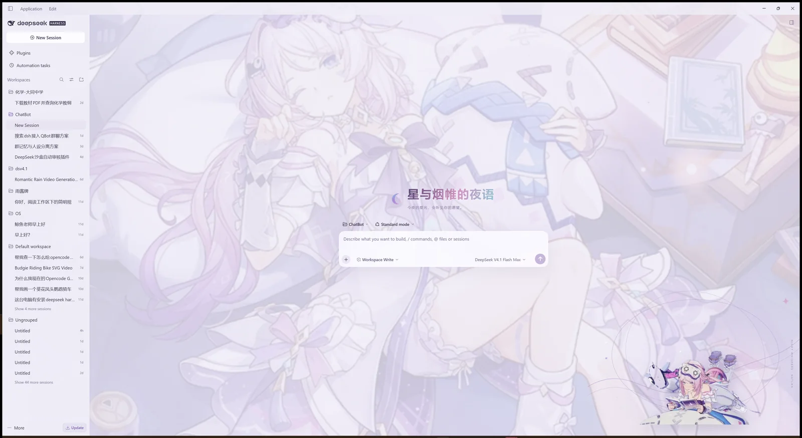
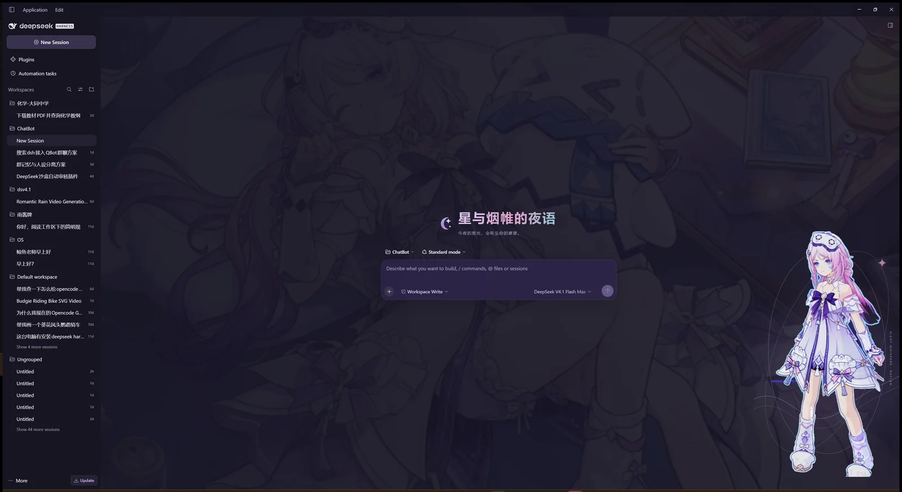

# dsh-citlali-veil-theme · 茜特菈莉「星帷漫游」

《原神》茜特菈莉新衣装「星与烟帷的夜语」主题的 DeepSeek Harness 皮肤。将星夜卧室铺满工作区，搭配透明立绘、玻璃材质和轻量持续动画。



## 特性

- 全页新衣装场景，保留文字与输入区的清晰层次。
- 浅色「星雾」与深色「夜帷」完整配色。
- 半透明侧栏、玻璃输入框、浮层、描边与柔和阴影。
- 无边框角色立绘、星轨、轻纱与渐变欢迎语。
- 背景漂移、错峰星芒与轻微呼吸动画；页面隐藏时暂停，支持减少动态效果。
- 皮肤总开关、插画开关、明暗切换，以及 0–80% 背景淡化滑杆。
- 全部美术本地内嵌，运行时无需联网下载素材。

不包含人格、表情包、上传管理或桌宠交互。

## 安装

### 从 GitHub 安装

```powershell
dsh plugin --profile desktop add github:syhneversigh/dsh-citlali-veil-theme
```

这会跟随 `main` 分支的最新代码。安装后重启 DSH 或刷新页面。

### 从 Release 安装

下载 [dsh-citlali-veil-theme-1.0.0.tgz](https://github.com/syhneversigh/dsh-citlali-veil-theme/releases/download/v1.0.0/dsh-citlali-veil-theme-1.0.0.tgz)，然后运行：

```powershell
dsh plugin --profile desktop add "C:\path\to\dsh-citlali-veil-theme-1.0.0.tgz"
```

把路径替换为实际下载位置。Web profile 可将命令中的 `desktop` 改为 `web`，但本项目目前只在桌面版进行了界面验收。

建议同一时间只启用一个皮肤。安装后在 **Settings → General → 茜特菈莉 · 星帷漫游** 调整明暗、插画和背景淡化。



## 从源码构建

需要 Node.js 18 或更新版本，无第三方运行时依赖。

```powershell
npm run build
npm run check
npm run pack:local
```

安装包生成在 `dist/dsh-citlali-veil-theme-1.0.0.tgz`。

## 版权与非官方声明

本插件为非官方个人主题，与米哈游、HoYoverse、DeepSeek 及其关联方没有隶属、合作或背书关系。

茜特菈莉、《原神》及角色美术版权归原权利人所有。素材来源与编辑方式见 [`assets/source/sources.json`](assets/source/sources.json)。官方衣装展示：<https://ys.mihoyo.com/main/news/detail/164913>。

代码当前以 `UNLICENSED` 发布，未附加开源许可证。
